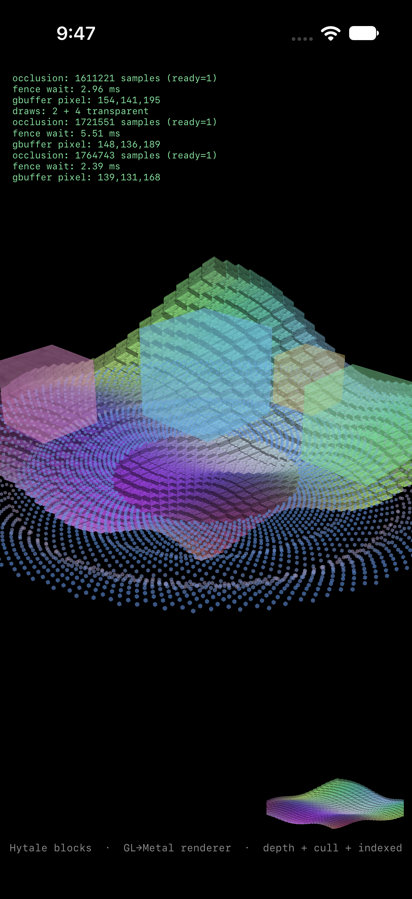
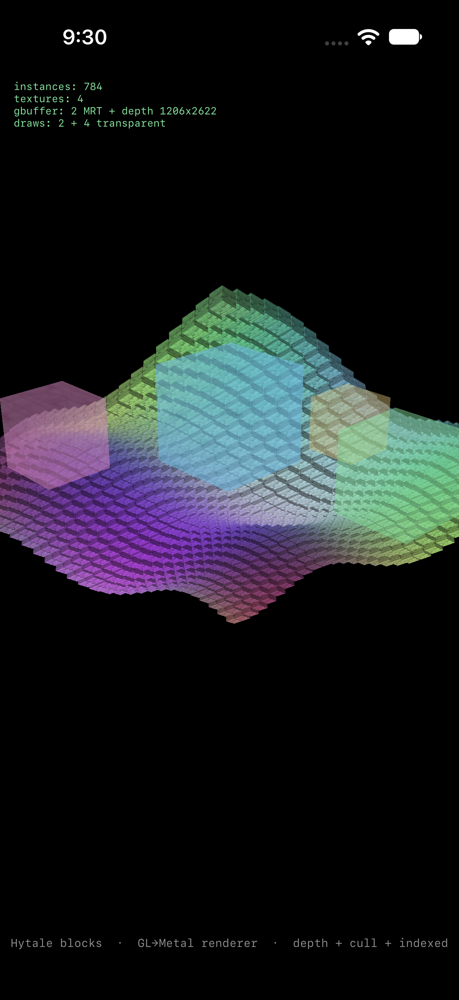

# Hytale for iOS

**Retargeting a .NET 10 NativeAOT game client to the iOS Simulator, and rebuilding its OpenGL renderer on Metal, one verifiable gate at a time.**

Hytale's own shaders and textures, drawn on Metal by the shim. A test scene, not the game.

---

> ## Archived (2026-10-18)
>
> This project was stopped by the author's decision. It is published as a record of
> what was built and measured, not as a work in progress.
>
> The client still halts at its launcher/account verification, which requires a
> validated premium session. That check was **not** bypassed, stubbed or patched,
> and will not be. Everything *below* that gate was built and verified, and is
> documented here with the numbers that were actually measured.

A plain-language version of this page, with a guide to reusing the pieces, is in
[WRITEUP.md](WRITEUP.md).

## What this is

Hytale ships a macOS client built with **.NET 10 NativeAOT** that renders through
desktop **OpenGL 4.1**. iOS has no desktop OpenGL and forbids JIT, so neither half
of that stack can run there unchanged.

This project asked a narrow question: *can the shipping binary run on the iOS
Simulator and draw through Metal?* It answered it in gates, each testing one
risky assumption before the next was attempted. The result is a live execution
chain, a working GL→Metal translation layer proven against Hytale's own shaders,
and a precise measurement of how much of the graphics surface is actually covered.

## Results

| Measure | Result |
|---|---|
| Shaders translated to Metal | **59 / 68** (9 failures are carving artifacts; none are Metal limits) |
| GL entry points in the client | **145** |
| Entry points reachable through the built shim | **65 / 145** |
| Unimplemented | **80** |
| GL exports in `libHytaleGL.dylib` | **71** |
| Standalone renderer coverage | **67** entry points, deferred + instanced + compute + MSAA |
| Frames drawn by the game itself | **0**, blocked before the first draw |

## Status board

| Area | State | Evidence |
|---|---|---|
| Shaders → Metal | ✅ **59 / 68** | 9 failures are carving artifacts; none are Metal limits |
| GL surface mapped | ✅ **145 classified** | 97 direct · 41 glue · 7 unsupported |
| Client binary on iOS | ✅ | NativeAOT boots, managed code runs, real .NET exceptions |
| Client as an iOS app | ✅ | UIKit window, iOS-built SDL3, launcher modal |
| GL routing through SDL | ✅ | 71 exports, no byte of the game binary patched |
| Standalone renderer | ✅ **67 entry points** | Deferred, instancing, compute, MSAA, blending, fences |
| 4× MSAA with resolve | ✅ **fixed** | Missing `rasterSampleCount`; 6.4 M occlusion samples |
| Renderer wired into the client | 🟡 **plumbed, never exercised** | The game stops before its first GL call |
| Surface manifest + probe | 🟡 **65 / 145 reachable** | Probe completes a frame; the triangle does not rasterize |
| Game reaches its main menu | ⛔ **not pursued** | Launcher/account verification; deliberately not bypassed |
| Physical iPhone | ⬜ **not attempted** | Simulator only, by choice |

## Architecture

~~~mermaid
flowchart TD
    A["HytaleClient .NET 10 NativeAOT, retargeted macOS → iOS"] -->|"dlsym SDL_GL_GetProcAddress"| B["SDL3.dylib built here, patched"]
    B -->|"asks HytaleGL_GetProcAddress first"| C["libHytaleGL.dylib C-ABI GL over Metal"]
    C -->|"known → pointer unknown → NULL"| D["Metal"]
    B -.->|"NULL → system GL"| E["(unavailable on iOS)"]
    L["Launcher / account verification"] -. "blocks startup before any GL call" .-x A
~~~

No game binary is patched. The client already resolves GL through SDL, and the SDL
it loads is one we build.

## The five gates

| Gate | Question | Outcome | Evidence |
|---|---|---|---|
| **1** | Can Hytale's shaders exist on iOS? | **59 / 68** translate to valid Metal; 0 fail for Metal reasons | `REPORT.md`, `shaders/`, `build/` |
| **2** | Does the client binary boot on iOS? | **Yes**: NativeAOT starts, managed code runs, real .NET exceptions | `gate2/README.md` |
| **3** | Does it run as an iOS app? | **Yes**: UIKit window, iOS SDL3, then the launcher modal | `gate3/README.md` |
| **4** | Can SDL route GL into our shim? | **Yes**: hook + graceful fallback, no binary patching | `gate4/README.md` |
| **5** | Is the whole chain wired? | **Yes**: `HytaleClient → SDL3 → libHytaleGL → Metal` | `gate5/README.md` |
| **M0–M1** | How much of the surface actually works? | **65 / 145 reachable**; probe runs end to end | `harness/README.md` |

## Showcase: the renderer, in pictures

Every frame below was drawn by `slice/`, the standalone GL→Metal app, using
Hytale's own shaders and textures. They are **test scenes, not the game**. Each was
added to prove one subsystem before the next was attempted, which is how 67 entry
points could be exercised together without the client ever issuing a draw.

<table>
<tr>
<td align="center" width="33%"> <b>Deferred</b> 2-MRT GBuffer · N·L composite</td>
<td align="center" width="33%"> <b>Instancing</b> 784 blocks · one draw call</td>
<td align="center" width="33%"> <b>Compute</b> 4,000 particles · emulated transform feedback</td>
</tr>
<tr>
<td align="center"> <b>Blending</b> forward transparency · depth masks</td>
<td align="center"> <b>4× MSAA</b> multisample resolve · occlusion query</td>
<td align="center"><b>67 entry points</b> GL calls implemented over Metal, exercised in one scene graph</td>
</tr>
</table>

The same shim is what the client's patched SDL is wired into. The only difference
between this gallery and the game is that the game never gets to issue the draw.

## The hard parts

### 1. Shaders: GLSL → SPIR-V → Metal

The 68 shaders and 27 includes are plain UTF-8 inside the client binary, under
`HytaleClient.Graphics.Shaders.*.glsl`. They were carved out by offset, run
through **glslang 16.6.0** and **SPIRV-Cross**, and compiled. Nothing was hand-edited
to force a pass. The nine failures are extraction artifacts: duplicated functions,
a block cut mid-file, a shader whose `main` sits behind an unset permutation
guard, not expressions Metal cannot represent.

### 2. The shim: OpenGL 4.1 on Metal

`libHytaleGL` implements the GL surface over Metal behind a C ABI. The parts
that had no direct mapping:

| Problem | Approach |
|---|---|
| Transform feedback | Emulated with a compute kernel that writes the buffer the vertex stage reads |
| Multisampled textures | Render to an MSAA target, resolve into a sampleable texture |
| Occlusion queries | `MTLVisibilityResultBuffer` |
| Fences | Command-buffer completion handler + semaphore |
| `glPolygonMode`, GPU timers | No iOS equivalent; accepted and documented |

The renderer was developed against a standalone harness, `slice/`, which
exercises deferred rendering, 784-instance draws, 4,000-particle compute, MSAA,
blending, scissor, fences and buffer readback, 67 entry points in total.

A recurring lesson: **shims fail through leaked state**. Highlights from the bug log:

- A frame ended inside every draw: 65 cubes became 65 passes, each clearing the screen.
- A stale VAO silently skipped every later draw.
- A uniform buffer and attribute fetch shared slot 1; attributes moved to slot 8.
- Integer division made the aspect ratio 0, producing NaN matrices and a black screen that looked like a broken GBuffer.
- Stage-namespace collision: a 16-byte fragment colour overwrote a 64-byte vertex matrix.
- MSAA albedo rendered at ~25% brightness because the pipeline's `rasterSampleCount` stayed at 1. One line, plus carrying the count through the render-target key.

### 3. Routing: no patching of the game

The client resolves every GL function through `SDL_GL_GetProcAddress`. Because
the SDL it loads is ours, two small patches route the entire GL surface into
Metal without touching a byte of the game: a constructor that preloads the shim,
and a hook that consults it before SDL's own loader. Both hunks are in
`harness/vendor/README.md`.

### 4. The harness: measuring the surface honestly

The last work built a test harness rather than chasing the game loop. It answers
three separate questions that are usually conflated:

| Question | Method | Result |
|---|---|---|
| **Reachable**: does SDL return a pointer? | resolve all 145 manifest names through the real chain | **65 / 145** |
| **Callable**: does a call survive? | one triangle through the dylib | **yes**, no crash |
| **Conformant**: are the pixels right? | FBO readback vs clear colour | **no**, clear colour only |

It also produced a machine-readable manifest (`harness/manifest/gl.json`) from
four independent sources (the declared surface, the SDK's `gl3.h`, `nm`
on the dylib, and the Swift source) and generated the `GetProcAddress` dispatch
table from the `@_cdecl` declarations. That removed 64 hand-typed
`@convention(c)` casts, any one of which could corrupt the stack at call time.

## What was never done

The game has never drawn a frame. Startup stops at the launcher check, so the real
per-frame GL profile was never captured. Beyond graphics, the app host, touch input,
audio, the Noesis UI layer, the 3.7 GB asset budget and the Java server were never
started. The probe's triangle renders clear colour only (pipeline creation silently
returns nil), and that bug was open when the project stopped.

## Repository layout

~~~text
.
├── README.md                 this file
├── REPORT.md                 shader and GL-surface spike
├── VERDICT.md                static GL analysis
├── GL-SURFACE.md             the 145 entry points, classified
├── shaders/  build/          carved GLSL and generated Metal (gitignored)
├── machomorph/               Mach-O retargeting tool
├── trace.sh  tracer*.c       live trace attempt (blocked by hardened runtime)
├── gate2/                    client binary on iOS
├── gate3/                    client as an iOS app
├── gate4/                    SDL → libHytaleGL routing, shim sources
├── gate5/                    fully wired Hytale.app
├── slice/                    standalone GL→Metal renderer app
└── harness/                  manifest, generated dispatch, probe
    ├── manifest/             gen_manifest.py → gl.json, COVERAGE.md
    ├── gen/                  emit_switch.py → dispatch table
    ├── probe/                GLProbe.app sources
    ├── vendor/               patched SDL3.dylib + its two hunks
    ├── build.sh              dylib + manifest + probe
    └── run_probe.sh          install and launch on a simulator
~~~

## Reproducing

### Requirements

- macOS with Xcode and the iOS Simulator runtime
- Metal toolchain: `xcodebuild -downloadComponent MetalToolchain`
- Python 3 (stdlib only) for the generators
- For the shader work only: glslang and SPIRV-Cross (removed from the repo to keep it small)

### 1. Probe harness: runs today

~~~sh
./harness/build.sh      # dylib (whole-module), manifest, GLProbe.app
./harness/run_probe.sh  # boots a simulator, installs, launches, collects the report
~~~

Expected output: `reachable: 65`, `fboComplete: true`, `presented: true`,
and `nonBackground: 0`, which is the known open bug. Artefacts land in
`harness/out/` (`report.json`, `frame.png`).

### 2. Shader translation: tools must be re-cloned

~~~sh
brew install glslang
git clone --depth 1 https://github.com/KhronosGroup/SPIRV-Cross
./tools/glslang/bin/glslang -G --auto-map-locations --auto-map-bindings \
    -DKBUFFER_SLOTS=4 -DKERNEL_SIZE=3 -DNB_SAMPLES=16 \
    build/s01.vert -o build/s01.spv
SPIRV-Cross/spirv-cross build/s01.spv --msl > build/s01.metal
~~~

The original runs used glslang 16.6.0. The 68 carved sources are in `shaders/`.

### 3. The client: needs your own game install

No game binaries or assets are in this repository. To repeat Gates 2–5 you need your
own licensed copy, then:

~~~sh
python3 machomorph/machomorph.py /path/to/HytaleClient -o gate2/work/HytaleClient \
  -p iossimulator -v 27.0 --no-libraries --darwin-extsn \
  --weaken-symbol _SecKeychainOpen   # 19 symbols; see gate2/README.md
codesign -f -s - gate2/work/HytaleClient
~~~

Package it with `harness/vendor/SDL3.dylib`, an `Info.plist`, and an
`Assets/` directory, then install with `xcrun simctl`. Gate 3's README
records where it stops.

### Pitfalls worth knowing

- **Build the dylib with `-whole-module-optimization`.** Without it, `@_cdecl` thunks are emitted per source file and the link fails with 71 duplicate symbols.
- **Keep the Swift module cache inside the workspace** (`-module-cache-path`); sandboxed environments deny the default `/var/folders` path.
- **`simctl launch --console` needs a FIFO outside the sandbox.** The collector reads the report from the app container instead.
- **`glReadPixels` only works against an FBO** in this shim; the default framebuffer is present-only.

## Scope and legal

- **Archived, not completed.** Work stopped on 2026-10-18 by the author's decision.
- Private research and learning project. Hytale binaries, assets and shaders are not distributed here; anything game-derived is excluded by `.gitignore` and remains the property of its owners.
- Vendored components keep their own licenses: machomorph is Apache-2.0, and the bundled SDL3 is zlib, with its notice in `harness/vendor/SDL3-LICENSE.txt`.
- Not affiliated with or endorsed by Hypixel Studios or the Hytale team. Hytale is a trademark of its owners.
- The launcher/account verification check was **not** bypassed. The project stopped rather than circumvent that access-control gate. Anything beyond personal experimentation needs the rights holder's permission.

## Acknowledgements

Built as an AI-assisted engineering project. The work was driven and reviewed
end-to-end, with a powerful AI model handling implementation, measurement and
documentation. Every number in this README comes from a run recorded in the
repository rather than an estimate.

Standing on: **machomorph** from the macos-to-ios project, **glslang**, **SPIRV-Cross**,
and **SDL 3.4.18**.
