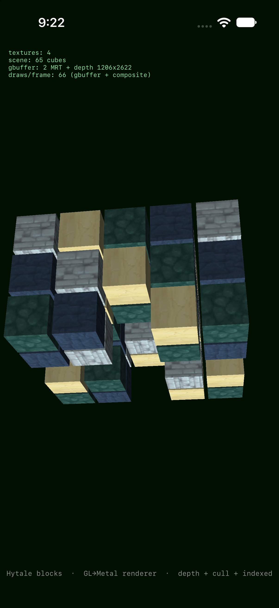
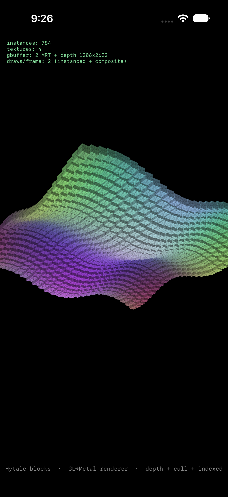
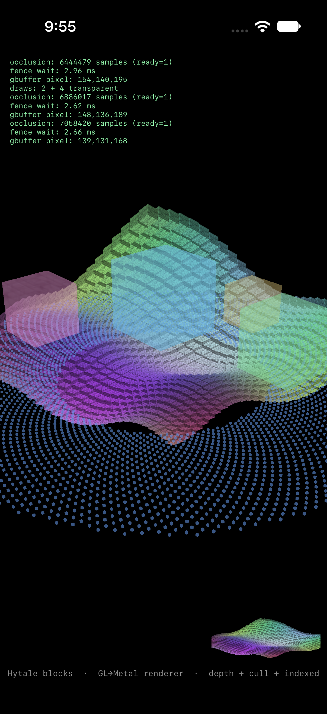

# Hytale for iOS: what it is, and how to build on it

This document comes in two parts. The first explains the project without assuming
any programming knowledge. The second is the engineering account, followed by a
practical guide to reusing or continuing the work.

---

## Part 1: for everyone

### The one-paragraph version

Hytale is a large game built for Mac and Windows. This project asked whether the
Mac version could run on an iPhone simulator, which is an iPhone emulated on a Mac.
It got remarkably far. The game starts, its own code runs, and it creates a window
on the simulated iPhone. Then it stops at a screen asking to be started by the
official Hytale launcher. The project stopped there on purpose, because getting past
that screen means defeating a lock that checks whether you own the game.

### What was actually achieved

Think of the work as building a translator. The game speaks OpenGL, the graphics
language a Mac understands. An iPhone speaks Metal, a different language for the
same job. The project built a translator that takes each instruction from the game
and redoes it in Metal. There were 145 different instructions to cover.

The game's visual effects are written as small programs called shaders. iPhones do
not understand the language they are written in. 68 shaders were cut out of the
game file and converted one by one. 59 came out working. None of the failures were
because an iPhone physically cannot do it.

The game's window, its startup code and its own error handling all run on the
simulated iPhone. The translator draws Hytale's own art correctly. What has never
happened is the game itself drawing a frame of gameplay.

### How far it got, in plain terms

| Question | Answer |
|---|---|
| Does the game start on an iPhone? | Yes |
| Does the game's own code run? | Yes |
| Does the game create a window? | Yes |
| Does the game draw gameplay? | No |
| Does the translator draw the game's art? | Yes |
| Can you play it? | No |
| Why not? | The launcher check stops it first |

### Why it stopped

The game refuses to continue unless an external launcher confirms a valid account
session. That is a lock on a commercial product. Picking it is not research, it is
circumvention, and it would not even produce a working game. The check depends on a
real credential, so forcing the branch leaves the program running on a broken one.

The project stopped instead. The interesting engineering sits below that lock, and
that part was finished and measured.

These are test scenes drawn by the translator with Hytale's own shaders and
textures, not screenshots of the game.

---

## Part 2: for engineers

### The execution chain

~~~text
HytaleClient  (.NET 10 NativeAOT, retargeted macOS -> iOS)
      |
      | dlsym("SDL_GL_GetProcAddress")
      v
SDL3.dylib  (built here, two patches)
      |
      | HytaleGL_GetProcAddress first
      v
libHytaleGL.dylib  (C-ABI OpenGL 4.1 over Metal)
      |
      v
Metal
~~~

No byte of the game binary is patched. The client already resolves GL through SDL,
and the SDL it loads is ours.

### The numbers

| Measure | Result |
|---|---|
| Shaders translated | 59 of 68 |
| GL entry points in the client | 145 |
| Reachable through the built shim | 65 |
| Unimplemented | 80 |
| GL exports in the dylib | 71 |
| Standalone renderer coverage | 67 entry points |
| Frames drawn by the game | 0 |

### Four things worth reading the code for

**Routing without patching.** The client resolves every GL function through
SDL_GL_GetProcAddress. Because we build the SDL it loads, two small patches, a
constructor that preloads the shim and a hook in the lookup, redirect the entire
surface. See gate4 and harness/vendor/README.md.

**Transform feedback on Metal.** Metal has no equivalent, so the shim runs a
compute kernel that writes the buffer the vertex stage then reads. See
slice/deferred/particles.comp.

**The MSAA bug.** Albedo resolved at roughly 25% brightness and looked like a
multi-attachment resolve problem. The real cause was a missing rasterSampleCount:
a one-sample pipeline was writing one of four samples, and the resolve averaged it
with three cleared ones. One line, plus carrying the count through the pipeline
cache key.

**Generated dispatch.** The GetProcAddress table used to be 64 hand-typed
@convention(c) casts. harness/gen/emit_switch.py now reproduces all of them from
the Swift declarations, and a wrong signature is a compile error instead of a
stack corruption. See harness/README.md.

### The harness

The last milestone built measurement rather than more features. It separates three
questions that are usually merged into one inflated number:

| Question | Method | Result |
|---|---|---|
| Reachable: does SDL return a pointer? | resolve all 145 names through the real chain | 65 of 145 |
| Callable: does a call survive? | one triangle through the dylib | yes, no crash |
| Conformant: are the pixels right? | FBO readback against clear colour | no, clear colour only |

The manifest is generated from four independent sources: the declared surface, the
SDK headers, nm on the dylib, and the Swift source. It fails on drift.

### The open bug

The probe completes a frame, the FBO reports complete, and the default framebuffer
presents. The triangle does not rasterize. Pipeline creation returns nil when the
program has no vertex or fragment library, so the most likely cause is shader
translation or makeLibrary failing silently. HUD.log now mirrors to
/tmp/hytalegl.log, and the probe ships the tail of that file in report.json. That is
where to look first.

---

## Part 3: how to pick this up

### Run something in five minutes

You need macOS, Xcode, the Metal toolchain, and Python 3. Nothing else.

~~~sh
./harness/build.sh      # builds the dylib, the manifest and GLProbe.app
./harness/run_probe.sh  # boots a simulator, installs and launches
~~~

Expected output: reachable 65, fboComplete true, presented true, and the known
open bug. Reports land in harness/out/.

### Where to start, depending on what you want

| Goal | Start here |
|---|---|
| Understand the GL to Metal translation | slice/ and slice/README.md |
| Measure or extend entry point coverage | harness/ |
| Port another .NET NativeAOT app | gate2/ and machomorph/ |
| Reuse the SDL hook in your own project | harness/vendor/README.md |
| Understand why the client stops | gate3/README.md |

### What you need for the client

No game binaries or assets are in this repository. Repeating Gates 2 to 5 needs
your own licensed copy. gate2/README.md has the retarget command, and gate3/README.md
records where it stops.

### Good first tasks if you continue it

1. Fix the probe triangle. Read logTail in report.json, then log the pipeline
   guard in GLContext.pipeline.
2. Fill the remaining 80 entry points. The manifest lists them by group, and
   COVERAGE.md shows where the gaps are concentrated.
3. Build the app host: window, input and lifecycle around the client.
4. Tackle the asset budget. About 3.7 GB has to fit inside iOS memory limits.

### What is reusable beyond Hytale

- The Mach-O retargeting approach in gate2 and machomorph.
- The SDL interposition pattern, which works for any app that resolves GL through
  SDL.
- The manifest plus generated dispatch design, which applies to any large C ABI
  surface written in Swift.
- The reachable, callable, conformant split for measuring a compatibility layer
  honestly.

---

## Scope

The project is archived. It stopped on 2026-10-18 by the author's decision, at the
launcher verification gate, which was not bypassed. It is licensed GPL-3.0, ships
no game assets, and is not affiliated with Hypixel Studios.
